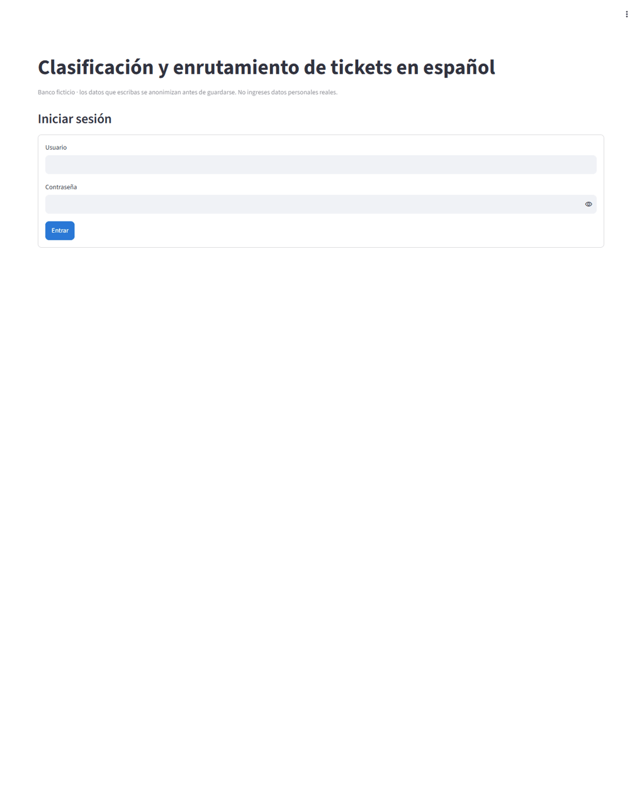
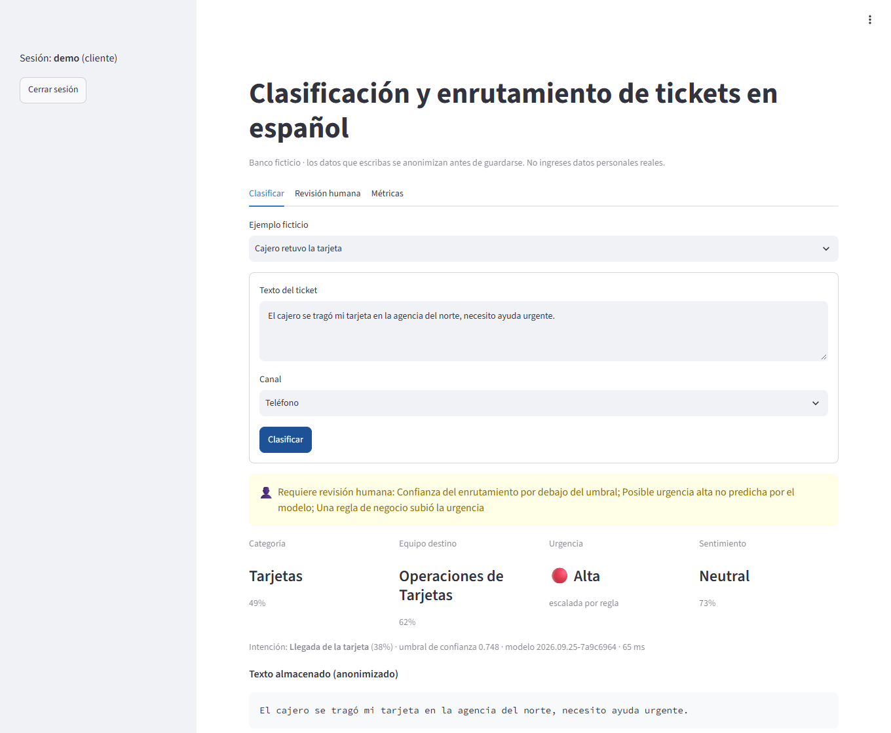
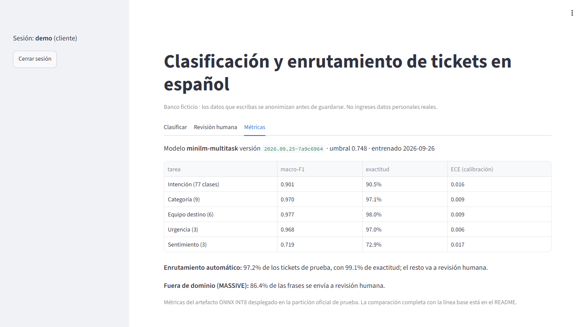
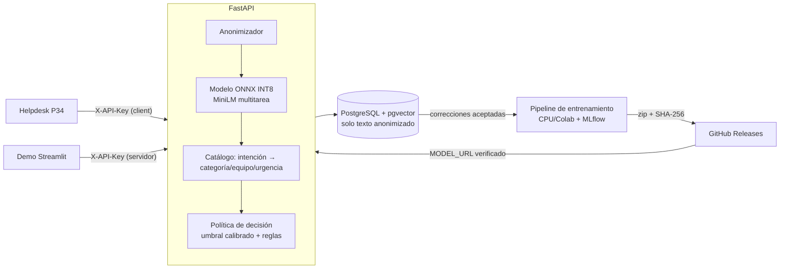
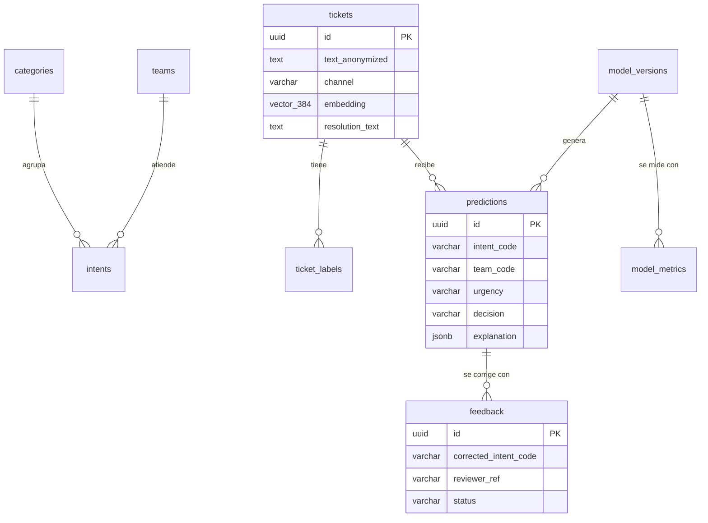
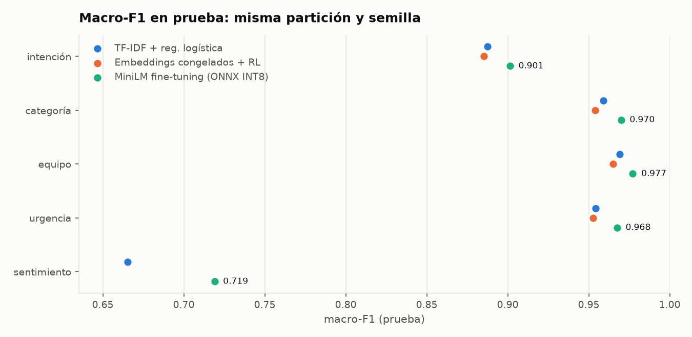
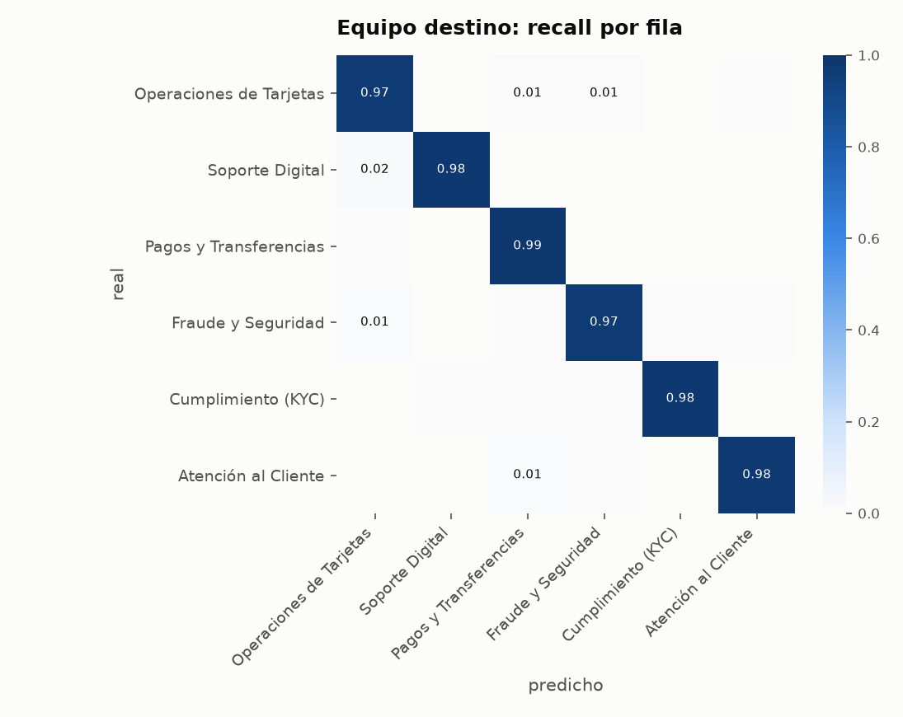
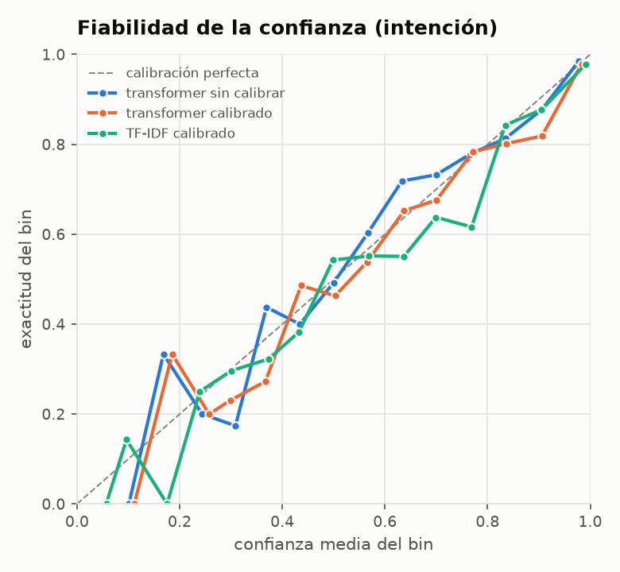

# nlp-tickets-es

Clasifica tickets de soporte en español (intención, categoría, urgencia y sentimiento), sugiere el equipo destino y decide cuándo un caso necesita **revisión humana**. Antes de procesar cualquier texto anonimiza cédulas, RUC, teléfonos, tarjetas, correos y nombres.


**Demo:** _pendiente de publicar (Streamlit Community Cloud)_ · **API:** _pendiente (Render)_ · **Usuario de prueba:** `demo` (rol cliente, sin permiso para corregir); la contraseña se publica junto con la demo. Las API keys viven solo en el servidor.



| Revisión humana por baja confianza y regla de urgencia | Métricas del modelo desplegado |
|---|---|
|  |  |

## Problema que resuelve
En una mesa de ayuda bancaria, cada ticket mal enrutado rebota entre equipos y retrasa los casos urgentes (tarjetas robadas, consumos no reconocidos). Clasificar a mano no escala, y automatizar sin control choca con la **LOPDP de Ecuador**: exige minimizar los datos personales (art. 10) y protege frente a decisiones solo automatizadas (art. 20). Este servicio enruta automáticamente lo que puede predecir con fiabilidad calibrada, manda el resto a una persona y guarda solo texto anonimizado. Está pensado para integrarse con el helpdesk **P34**.

## Funcionalidades
- **Anonimización previa** con reglas verificables: cédula (verificador módulo 10), RUC (SRI, art. 3), teléfonos (plan de numeración ARCOTEL), tarjetas (Luhn), cuentas, correos, URL y nombres. Tiene 60 tests.
- **Clasificación jerárquica**: el modelo predice 1 de 77 intenciones y un **catálogo versionado en la base** deriva categoría, equipo y urgencia. Cambiar el enrutamiento no exige reentrenar.
- **Revisión humana con umbral calibrado**: *temperature scaling* y un umbral elegido en validación para un 99 % de exactitud en lo que se enruta solo. Además, las señales de fraude escalan la urgencia.
- **Explicación** de cada predicción (palabras más influyentes por oclusión y reglas aplicadas), guardada con la versión del modelo que decidió.
- **Búsqueda semántica** de tickets resueltos parecidos (embeddings + pgvector HNSW) para sugerir la solución anterior.
- **Bucle de retroalimentación**: los revisores corrigen, las correcciones se auditan y alimentan el siguiente reentrenamiento.
- **Evaluación honesta**: misma partición y semilla para la línea base y el transformer, *bootstrap* pareado y métricas del **artefacto ONNX INT8 desplegado**.
- **MLflow** para registrar cada entrenamiento y **ficha del modelo** con limitaciones y sesgos.

## Arquitectura


## Stack y por qué
| Capa | Tecnología | Motivo |
|---|---|---|
| Modelo | `paraphrase-multilingual-MiniLM-L12-v2` (Apache 2.0), fine-tuning multitarea | Modelo destilado de 118 M parámetros que cabe en 512 MB tras INT8. Un solo encoder sirve para clasificar y para la búsqueda semántica |
| Línea base | scikit-learn: TF-IDF (palabras + caracteres) + regresión logística | Rápida, interpretable y exigente: el transformer tiene que ganarle con la misma partición |
| Inferencia | ONNX Runtime + `tokenizers` | Sin PyTorch en producción: imagen pequeña y ~5 ms por ticket en CPU local |
| API | FastAPI + Pydantic v2 | Validación estricta y OpenAPI automático para el helpdesk P34 |
| Datos | PostgreSQL 17 + pgvector 0.8.6, SQLAlchemy 2 + Alembic | Datos relacionales y vectoriales en una sola base; migraciones versionadas |
| Experimentos | MLflow (SQLite) | Parámetros, métricas y artefactos de cada corrida |
| Demo | Streamlit | Gratis en Community Cloud; las claves quedan en el servidor |
| DevOps | Docker multi-stage, Compose, GitHub Actions, gitleaks, uv | Reproducible y con las versiones fijadas |

## Modelo de datos

Detalle de campos, restricciones y fuentes: [docs/modelo-datos.md](docs/modelo-datos.md) · Investigación: [docs/investigacion.md](docs/investigacion.md).

## Cómo ejecutar en local
**Con Docker** (base, API y demo):
```bash
cp .env.example .env          # completa claves (>= 32 caracteres) y POSTGRES_PASSWORD
uv run nlp-tickets train      # o: uv run nlp-tickets fetch-model (con MODEL_URL y MODEL_SHA256)
docker compose up --build     # API en :8000 (/docs) y demo en :8501
```

**Sin Docker** (necesitas PostgreSQL con pgvector y `DATABASE_URL` en `.env`):
```bash
uv sync --all-groups
uv run nlp-tickets train               # descarga datos fijados, entrena, evalúa y exporta ONNX
uv run nlp-tickets migrate
uv run nlp-tickets register-model
uv run nlp-tickets seed
uv run uvicorn nlp_tickets.main:create_app --factory --port 8000
DEMO_API_KEY=... uv run --with streamlit streamlit run demo/app.py
```
Datos de prueba ficticios y resultados esperados: [docs/datos-prueba.md](docs/datos-prueba.md).

## Variables de entorno
| Variable | Descripción | Obligatoria |
|---|---|---|
| `DATABASE_URL` | PostgreSQL (`postgresql+psycopg://…`; Neon en producción) | Sí |
| `API_KEYS_CLIENT` | Claves del rol `client` separadas por coma (≥ 32 caracteres) | Sí |
| `API_KEYS_REVIEWER` | Claves del rol `reviewer` (pueden corregir) | Sí |
| `POSTGRES_PASSWORD` | Contraseña de la base en Docker Compose | Sí (Compose) |
| `CORS_ALLOWED_ORIGINS` | Orígenes permitidos separados por coma (sin `*`) | No |
| `RATE_LIMIT_PER_MINUTE` | Peticiones por minuto y por clave (defecto 60) | No |
| `MODEL_DIR` | Carpeta del modelo (defecto `artifacts/model`) | No |
| `MODEL_URL` / `MODEL_SHA256` | Paquete del modelo en GitHub Releases y su hash | Solo si no hay modelo local |
| `CONFIDENCE_THRESHOLD_OVERRIDE` | Umbral manual en lugar del calibrado | No |
| `DEMO_API_KEY` / `DEMO_REVIEWER_KEY` | Claves que usa la demo en el servidor | Demo |

## API
Swagger: `http://localhost:8000/docs` · Ejemplos: [docs/api.http](docs/api.http)

| Método | Ruta | Rol | Descripción |
|---|---|---|---|
| GET | `/health` | público | Liveness y versión del modelo |
| POST | `/api/v1/classify` | client | Anonimiza, clasifica, enruta y decide (`auto_route` / `human_review`) |
| POST | `/api/v1/tickets/similar` | client | Tickets resueltos parecidos a un texto |
| GET | `/api/v1/tickets/{id}/similar` | client | Tickets resueltos parecidos a un ticket guardado |
| POST | `/api/v1/feedback` | reviewer | Corrección humana auditada |
| GET | `/api/v1/catalog` | client | Categorías, equipos e intenciones (sincronización con P34) |
| GET | `/api/v1/model` | client | Versión activa, umbral y métricas |

<!-- METRICS:START -->
## Resultados
Partición oficial de prueba de BANKING77-ES-LA: **3 080 tickets**, nunca usados para elegir hiperparámetros. Todos los modelos usan la misma partición y semilla (hash `7a9c6964c0c8`). Entrenamiento 8 577 · validación 953. Versión `2026.09.25-7a9c6964`.

| Macro-F1 en prueba | TF-IDF + reg. logística | Embeddings congelados + RL | **MiniLM fine-tuning (ONNX INT8)** |
|---|---:|---:|---:|
| Intención (77 clases) | 0.887 | 0.885 | 0.901 |
| Categoría (9) | 0.959 | 0.954 | 0.970 |
| Equipo destino (6) | 0.969 | 0.965 | 0.977 |
| Urgencia (3) | 0.954 | 0.953 | 0.968 |
| Sentimiento (3) | 0.665 | — | 0.719 |

**Diferencia frente a TF-IDF** (bootstrap pareado, 1 000 réplicas, IC 95 %):

- Intención: **+0.014** [+0.004, +0.024]
- Equipo: **+0.008** [+0.001, +0.015]
- Sentimiento: **+0.054** [+0.040, +0.066]

| Enrutamiento y revisión humana | TF-IDF + RL | MiniLM (ONNX INT8) |
|---|---:|---:|
| Umbral de confianza del equipo (elegido en validación para 99 % de exactitud) | 0.818 | 0.748 |
| Tickets enrutados automáticamente (cobertura) | 93.5 % | 97.2 % |
| Exactitud de lo enrutado automáticamente | 99.2 % | 99.1 % |
| Frases fuera de dominio (MASSIVE) enviadas a revisión humana | 91.2 % | 86.4 % |
| ECE de intención (sin calibrar → calibrado) | 0.100 → 0.023 | 0.016 → 0.016 |

Artefacto desplegado: ONNX INT8 de **118 MB** (FP32: 470 MB). Coincidencia de predicciones FP32/INT8: 98.8 %. Latencia por ticket en CPU local: p50 5.2 ms · p95 9.6 ms.



| Equipo destino | Calibración |
|---|---|
|  |  |

Métricas completas: [reports/metrics.json](reports/metrics.json) · Ficha del modelo: [docs/model-card.md](docs/model-card.md).
<!-- METRICS:END -->

## Tests y cobertura
```bash
uv run pytest --cov   # unitarios + integración (Testcontainers con pgvector real)
```
<!-- TESTS:START -->
- **Unitarios:** anonimizador (cédula, RUC, teléfonos, tarjetas, nombres, idempotencia), validadores, catálogo, métricas, calibración, umbral, partición sin fuga, líneas base, reglas de urgencia, política de decisión, API keys, *rate limiting*, descarga verificada del modelo, login de la demo y generador del README.
- **Integración (Testcontainers + PostgreSQL 17 + pgvector):** migraciones idénticas a los modelos ORM, flujo completo de la API (401/403/413/422/429, CORS, cabeceras, anonimización persistida, búsqueda semántica, retroalimentación y exportación) y registro de versiones de modelo.
- **Modelo real:** 5 pruebas sobre el artefacto ONNX (se omiten en CI si no está descargado).
- **192 tests** (187 en CI + 5 del modelo real). **Cobertura:** 94,5 % en CI y 95,8 % con el modelo descargado (mínimo exigido 70 %). CI: gitleaks, ruff, mypy estricto, pytest y build de las imágenes Docker.
<!-- TESTS:END -->

## Despliegue
Todo gratis: **Neon** (PostgreSQL + pgvector), **Render** (API Docker, 0,1 CPU / 512 MB), **Streamlit Community Cloud** (demo) y **GitHub Releases** (pesos del modelo con SHA-256). Paso a paso y límites verificados en [docs/despliegue.md](docs/despliegue.md).

## Seguridad aplicada
- **LOPDP:** anonimización antes de persistir o registrar en logs; los errores 422 no devuelven la entrada; el revisor se guarda **seudonimizado** (hash); la revisión humana y la explicación cubren el art. 20.
- **Deny-by-default:** todo `/api/**` exige `X-API-Key`; roles `client` y `reviewer`; comparación en tiempo constante.
- **OWASP API Top 10:** UUID no enumerables (API1), *rate limiting* por clave (API4), límite de 32 KB por cuerpo y de 5 000 caracteres por texto, `extra="forbid"` en los DTO, CORS con orígenes explícitos, cabeceras (CSP, `nosniff`, `DENY`, HSTS en producción) y errores sin *stack traces*.
- **OWASP ML Top 10:** ML02 (solo correcciones `accepted`, una por ticket y con tope por reentrenamiento, trazables a la versión que las usó); ML06 (el modelo se verifica por SHA-256 antes de cargarse; ZIP sin rutas peligrosas).
- **Secretos** solo por entorno (la app no arranca sin ellos), gitleaks en CI y pre-commit, Docker con usuario no root, imágenes con versión fija y acciones de GitHub fijadas por SHA.

## Decisiones técnicas
- **BANKING77-ES-LA con etiquetas del original.** La traducción también tradujo las etiquetas (629 variantes para 77 clases), así que tomo la etiqueta del CSV original de PolyAI, fila a fila, y verifico la alineación en cada ejecución (99,96 %). Descarté TASS (licencia no comercial y sin derivados), MultiEURLEX (dominio jurídico, *ShareAlike*) y el corpus de Tobi-Bueck (sin español en HF, CC BY-NC).
- **Fuga de datos eliminada:** 184 frases de entrenamiento también estaban en prueba y había 289 duplicados. Los quito antes de partir; si no, las métricas salen infladas.
- **Intención → catálogo** en lugar de tres clasificadores. Categoría, equipo y urgencia salen de marginalizar las probabilidades, así que siempre son coherentes entre sí y el negocio cambia el enrutamiento sin reentrenar.
- **Umbral sobre la probabilidad del equipo**, no de la intención: la decisión de negocio es a quién enrutar. Confundir dos intenciones del mismo equipo no debe mandar el caso a una persona.
- **MiniLM multilingüe destilado** en vez de BETO o RoBERTa-BNE: licencia clara, cabe en 512 MB tras INT8 y ya está entrenado para similitud (sirve para pgvector). BETO advierte dudas de licencia comercial y RoBERTa-BNE está *deprecated*.
- **Congelar los embeddings de vocabulario** (96 M de 118 M parámetros): el entrenamiento en CPU es mucho más rápido y no se sobreajustan tokens raros. Con 8 hilos lógicos PyTorch iba 5 veces más lento que con 4 físicos; está medido y documentado.
- **Evaluar el ONNX INT8** y no el modelo en PyTorch: las métricas publicadas son las del artefacto que se despliega (la paridad FP32/INT8 está en el reporte).

## Roadmap
- [ ] Detector de fuera de dominio por similitud con los tickets conocidos (pgvector). Hoy el umbral envía a revisión el 86 % de las frases ajenas al banco, no todas ([ejemplos reales](docs/datos-prueba.md)).
- [ ] Etiquetar 300 tickets reales del dominio (con la propia herramienta) para medir el sentimiento fuera de Reddit.
- [ ] Recortar el vocabulario del tokenizador a español (modelo ~4 veces más pequeño).
- [ ] Rate limiting distribuido (Redis) si la API escala a varias réplicas.
- [ ] Corpus de tickets de TI en español (Tobi-Bueck, Kaggle) como segundo dominio.
- [ ] Detección de nombres con un NER de licencia compatible (MIT/Apache).

## Fuentes de datos y licencias
- **BANKING77-ES-LA**: Maita, Rivadeneyra-Vera et al. (2025), Centro de Ciencia de Datos POLI/USP. **CC BY 4.0**. https://huggingface.co/datasets/c2d-usp/banking77-es-la
- **BANKING77**: Casanueva et al. (2020), *Efficient Intent Detection with Dual Sentence Encoders*, NLP4ConvAI @ ACL. **CC BY 4.0**. https://github.com/PolyAI-LDN/task-specific-datasets
- **GoEmotions**: Demszky et al. (2020), ACL. **Apache 2.0**; traducción al español `mrm8488/go_emotions-es-mt` (Apache 2.0).
- **MASSIVE 1.1**: FitzGerald et al. (2023), ACL. **CC BY 4.0** (solo como conjunto fuera de dominio).
- **Modelo base**: `sentence-transformers/paraphrase-multilingual-MiniLM-L12-v2`, **Apache 2.0** (Reimers & Gurevych, 2020, EMNLP).
- Normativa: LOPDP (R.O. 459, 26-may-2021), SRI (Reglamento del RUC), ARCOTEL (Plan de Numeración), PCI DSS v4.0.1.
- Todas las fuentes, con fecha de consulta: [docs/investigacion.md](docs/investigacion.md) · Ficha del modelo: [docs/model-card.md](docs/model-card.md).

## Autor
**Diego Francisco Granda Zhingre** · [GitHub](https://github.com/DiegoFranciscoG) · [LinkedIn](https://www.linkedin.com/in/diego-francisco-g-61b793254/) · [Portafolio](https://diegofranciscog.github.io/)
