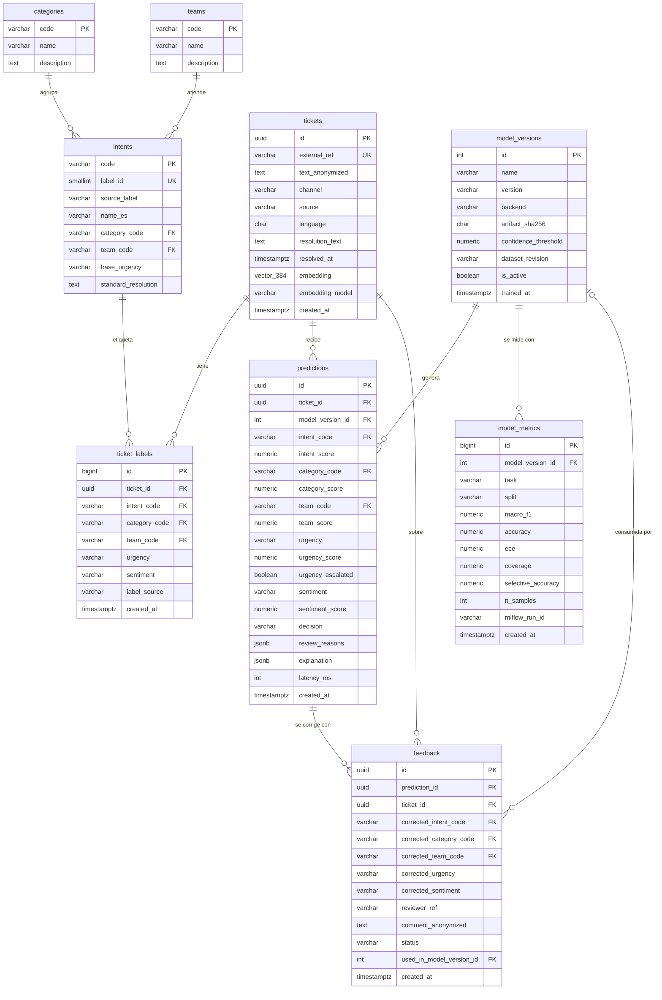

# Modelo de datos

PostgreSQL 17 + pgvector 0.8.6. Migraciones versionadas con Alembic (`migrations/`).
Los nombres de tablas y columnas están en inglés. Las reglas remiten a los identificadores de [investigacion.md](investigacion.md).

| Tabla (en el enunciado) | Tabla en el código |
|---|---|
| tickets | `tickets` |
| etiquetas | `ticket_labels` (más los catálogos `categories`, `teams` e `intents`) |
| predicciones | `predictions` |
| retroalimentacion | `feedback` |
| metricas_modelo | `model_metrics` (más el registro de versiones `model_versions`) |

## Diccionario de datos

Los catálogos se cargan desde `data/catalog/*.csv` (versionados) en la migración inicial.

### `categories`, `teams`: catálogos de enrutamiento
| Campo | Tipo | Restricción | Regla / fuente |
|---|---|---|---|
| `code` | `varchar(40)` | PK, `^[a-z_]+$` | Código estable que consumen P34 y la API. SUPUESTO 1 |
| `name` | `varchar(80)` | NOT NULL | Nombre visible en español |
| `description` | `text` | NULL | |

### `intents`: 77 intenciones de BANKING77 y su política de enrutamiento
| Campo | Tipo | Restricción | Regla / fuente |
|---|---|---|---|
| `code` | `varchar(60)` | PK | Nombre original normalizado a *snake_case* (D2) |
| `label_id` | `smallint` | UNIQUE, 0–76 | Orden oficial de etiquetas de BANKING77 (D2). Índice de salida del modelo |
| `source_label` | `varchar(60)` | NOT NULL | Etiqueta tal cual en el CSV original (`Refund_not_showing_up`, `reverted_card_payment?`) |
| `name_es` | `varchar(80)` | NOT NULL | Nombre en español |
| `category_code` | `varchar(40)` | FK → `categories` | SUPUESTO 1 |
| `team_code` | `varchar(40)` | FK → `teams` | SUPUESTO 1 |
| `base_urgency` | `varchar(10)` | CHECK `low/medium/high` | SUPUESTO 1: `high` = dinero en riesgo o fraude; `medium` = servicio fallido o dinero retenido; `low` = consulta |
| `standard_resolution` | `text` | NOT NULL | Resolución estándar de un banco ficticio. Se sugiere junto a los tickets parecidos |

### `tickets`: solo texto anonimizado
| Campo | Tipo | Restricción | Regla / fuente |
|---|---|---|---|
| `id` | `uuid` | PK | Evita IDs secuenciales enumerables (OWASP API1, S1) |
| `external_ref` | `varchar(64)` | UNIQUE, NULL | ID del ticket en el helpdesk P34 (idempotencia) |
| `text_anonymized` | `text` | NOT NULL, 1–5000 caracteres | **Nunca el texto original** (L1 art. 10 e, 37, 39) |
| `channel` | `varchar(20)` | CHECK `email/web/chat/phone/social/branch` | Canal de entrada |
| `source` | `varchar(20)` | CHECK `api/seed/dataset` | Origen del registro |
| `language` | `char(2)` | DEFAULT `es` | |
| `resolution_text` | `text` | NULL | Solución aplicada (anonimizada). Solo los tickets resueltos se sugieren como "parecidos" |
| `resolved_at` | `timestamptz` | NULL | |
| `embedding` | `vector(384)` | NULL, índice **HNSW `vector_cosine_ops`** | Embedding normalizado del modelo (M1, P4) |
| `embedding_model` | `varchar(80)` | NULL | Versión del modelo que generó el embedding. Solo se comparan embeddings del mismo modelo |
| `created_at` | `timestamptz` | NOT NULL, DEFAULT `now()` | |

### `ticket_labels`: etiquetas de referencia (*gold*)
| Campo | Tipo | Restricción | Regla / fuente |
|---|---|---|---|
| `ticket_id` | `uuid` | FK → `tickets` ON DELETE CASCADE | |
| `intent_code` | `varchar(60)` | FK → `intents`, NULL | |
| `category_code`, `team_code` | `varchar(40)` | FK, NOT NULL | Derivados del catálogo o corregidos por una persona |
| `urgency` | `varchar(10)` | CHECK `low/medium/high` | |
| `sentiment` | `varchar(10)` | CHECK `negative/neutral/positive`, NULL | D7 |
| `label_source` | `varchar(20)` | CHECK `dataset/human/catalog` | Trazabilidad de quién etiquetó |
| | | UNIQUE (`ticket_id`, `label_source`) | Una etiqueta vigente por origen |

### `model_versions`: registro de modelos desplegables
| Campo | Tipo | Restricción | Regla / fuente |
|---|---|---|---|
| `name`, `version` | `varchar` | UNIQUE (`name`, `version`) | p. ej. `minilm-multitask` / `2026.09.25-1` |
| `backend` | `varchar(20)` | CHECK `onnx/sklearn` | |
| `artifact_sha256` | `char(64)` | NOT NULL | Verificado antes de cargar el modelo (S2, ML06) |
| `confidence_threshold` | `numeric(4,3)` | 0–1 | Elegido en validación (E5) |
| `dataset_revision` | `varchar(80)` | NOT NULL | Revisión fijada del dataset (D1) |
| `is_active` | `boolean` | Índice único parcial `WHERE is_active` | Solo una versión activa |

### `predictions`: cada decisión automatizada queda auditada (L2)
| Campo | Tipo | Restricción | Regla / fuente |
|---|---|---|---|
| `id` | `uuid` | PK | |
| `ticket_id` | `uuid` | FK → `tickets` ON DELETE CASCADE | |
| `model_version_id` | `int` | FK → `model_versions` | Qué versión decidió (L2 art. 20) |
| `*_code`, `*_score` | `varchar`, `numeric(5,4)` | score 0–1 | Probabilidades calibradas (E4); categoría y equipo se obtienen marginalizando sobre las intenciones |
| `urgency_escalated` | `boolean` | NOT NULL | `true` si una regla de escalamiento subió la urgencia (SUPUESTO 2) |
| `decision` | `varchar(20)` | CHECK `auto_route/human_review` | Umbral de E5 |
| `review_reasons` | `jsonb` | NOT NULL, DEFAULT `[]` | p. ej. `["low_confidence", "high_urgency_low_margin"]` |
| `explanation` | `jsonb` | NOT NULL | Términos influyentes y reglas aplicadas (L2 art. 20 a, c) |
| `latency_ms` | `int` | ≥ 0 | Observabilidad |

### `feedback`: bucle de retroalimentación
| Campo | Tipo | Restricción | Regla / fuente |
|---|---|---|---|
| `prediction_id` | `uuid` | FK → `predictions` | |
| `corrected_*` | `varchar` | FK a catálogos, al menos uno NOT NULL (CHECK) | |
| `reviewer_ref` | `varchar(64)` | NOT NULL | **Seudónimo** del revisor (hash), no su nombre (L1 art. 4) |
| `comment_anonymized` | `text` | ≤ 1000 caracteres | Se anonimiza igual que los tickets |
| `status` | `varchar(10)` | CHECK `accepted/rejected`, DEFAULT `accepted` | Un administrador puede rechazar correcciones sospechosas (S2, ML02) |
| `used_in_model_version_id` | `int` | FK → `model_versions`, NULL | Trazabilidad: en qué reentrenamiento se usó |

### `model_metrics`: métricas por versión, tarea y partición
| Campo | Tipo | Restricción | Regla / fuente |
|---|---|---|---|
| `task` | `varchar(20)` | CHECK `intent/category/team/urgency/sentiment/ood` | |
| `split` | `varchar(20)` | CHECK `validation/test/ood` | La prueba oficial se usa una sola vez (E2) |
| `macro_f1`, `accuracy`, `ece` | `numeric(5,4)` | 0–1 | E1, E4 |
| `coverage`, `selective_accuracy` | `numeric(5,4)` | 0–1, NULL | E5 |
| | | UNIQUE (`model_version_id`, `task`, `split`) | |

## Datos de ejemplo (*seeds*)
- `data/seed/tickets_seed.csv`: 770 tickets **históricos resueltos** (10 por intención) tomados de la partición de entrenamiento de BANKING77-ES-LA (CC BY 4.0, con atribución). Se anonimizan, se les asigna canal y fecha ficticios con semilla fija y se resuelven con la `standard_resolution` de su intención.
- Ningún ticket del conjunto de **prueba** entra en los seeds, para que la búsqueda de parecidos no filtre información de evaluación.
- No contienen datos personales reales: las frases de BANKING77 fueron escritas para el corpus y además pasan por el anonimizador.
